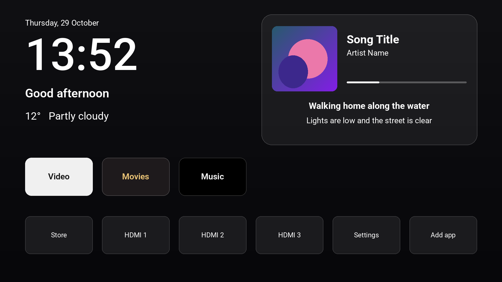
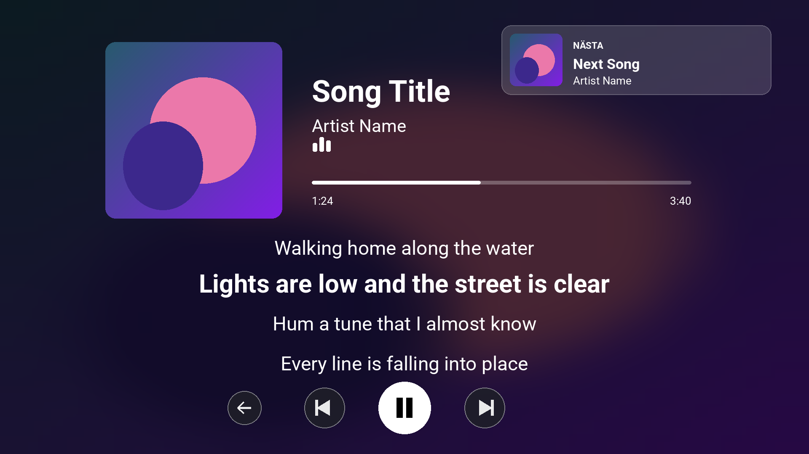
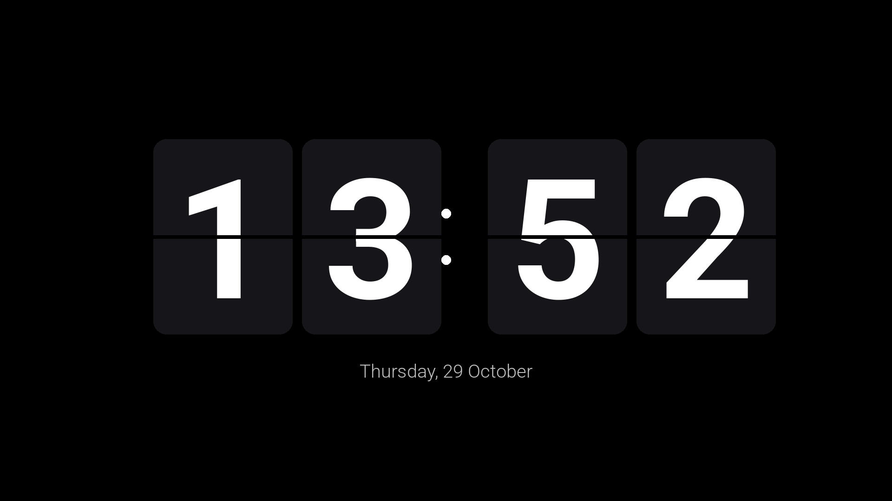

# 📺 TV Home

**A small, fast home screen (launcher) for Android TV, written in plain Java with no Gradle and no AndroidX.**

## 📸 Screenshots

  

  
  

Home screen · music screensaver with synced lyrics · flip clock. Shown with demo songs.

## ✨ Features

- 🕐 **Clock, greeting and weather** (Open-Meteo, no API key)
- 🏠 **Home info row** (optional): room temperature and more from my home server
- 🎵 **Now playing**: a glossy black widget with cover, title, artist, progress and synced lyrics from lrclib.net
- 🌙 **Screensavers**: a full-screen music screen with a blurred cover and on-screen remote controls (back / previous / play-pause / next), or a flip clock when nothing plays
- 🎨 **Wallpapers**: several built-in themes, or your own photo
- 🔒 **Private by design**: it uses Android's notification access only to follow the music player, and never reads your notifications

## ⚙️ How it works

- Built as a tiny native app: plain Java, compiled and signed with the Android SDK command-line tools, no Gradle and no libraries
- Works with any player through Android's media controls, and is tuned for my own music app, [Issa Music](https://github.com/MohammadIssa04/issa-music)
- Weather comes from Open-Meteo and lyrics from lrclib.net, both free and without API keys
- The optional home row reads a small JSON webhook from my home server ([homelab](https://github.com/MohammadIssa04/homelab))

## 🔒 About this repository

This repository is a showcase only. The source code is private.

---

Made by Mohammad Issa
